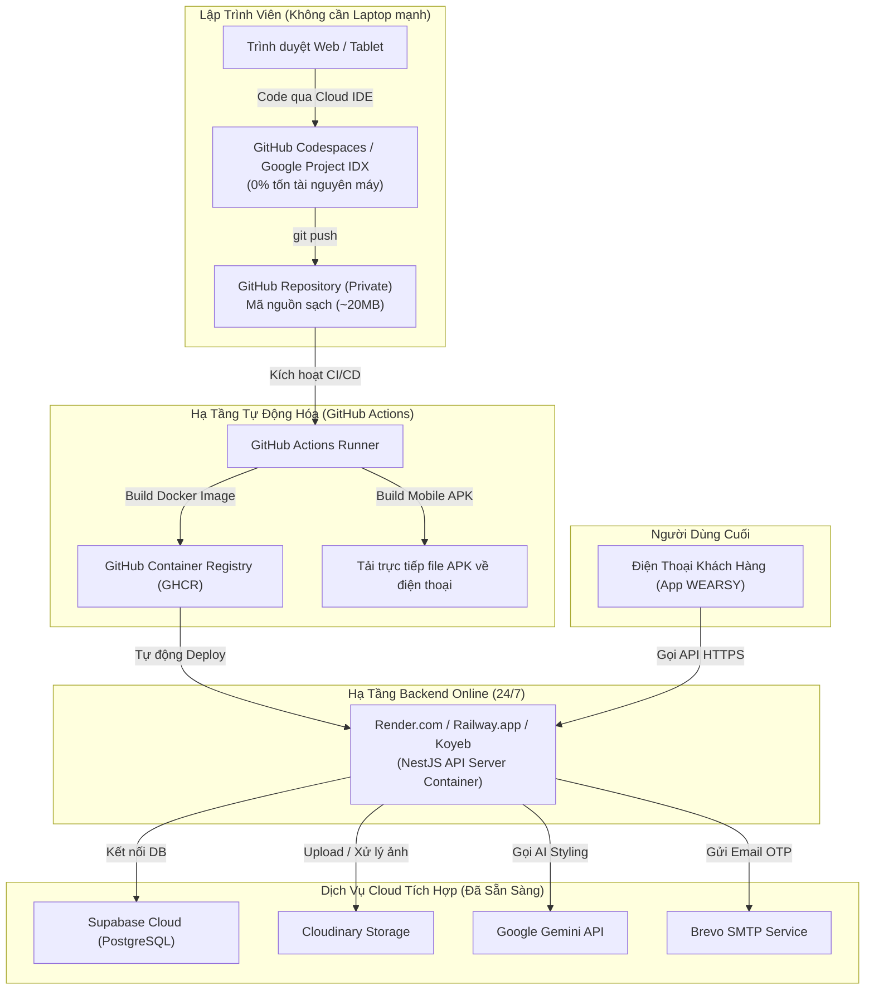

# Kế Hoạch Chuyển Đổi Toàn Bộ Dự Án WEARSY Lên Cloud (Không Cần Dùng Laptop)

## 1. Phân Tích Thực Trạng Dung Lượng (Giải Mã Con Số 5.08 GB & 53,950 Files)

Trước khi chuyển giao lên Cloud, việc giải mã nguyên nhân tại sao thư mục dự án trên máy bạn hiện tại có dung lượng **5.08 GB** với **53,950 Files** là tối quan trọng:

```
[Tổng Dung Lượng Trên Ổ Đĩa: 5.15 GB]
│
├── 🔴 Build Caches & Rác phát sinh khi chạy (99.6%): ~5.07 GB
│   ├── apps/mobile-client/build/         : 3,695 MB (~3.7 GB - Build Android/Gradle cache)
│   ├── apps/mobile-client/.dart_tool/    : 784 MB (Cache phân tích & Pub gói Flutter)
│   └── apps/api-server/node_modules/     : 588 MB (Gói thư viện Node.js cài cục bộ)
│
└── 🟢 Mã Nguồn Gốc Thật Sự (Chỉ 0.4%): ~15 - 20 MB
    ├── apps/mobile-client/lib/ + assets/ : ~14.4 MB (Code Flutter + Hình ảnh assets)
    ├── apps/api-server/src/              : ~0.15 MB (150 KB code Backend NestJS)
    └── infrastructure/ + .github/        : ~0.05 MB (Scripts, CI/CD workflows, Docker)
```

> [!IMPORTANT]
> **Toàn bộ 5.07 GB rác và phụ thuộc cục bộ đều đã được khai báo trong [.gitignore](file:///d:/FPTDocuments/FA26/EXE101/Project%20WEARSY/.gitignore)**.
> Khi đưa dự án lên Cloud qua Git (GitHub), bạn **CHỈ ĐẨY KHOẢNG 15 - 20 MB** mã nguồn sạch. Các nền tảng Cloud sẽ tự động tải thư viện và build ngầm trên server của họ, hoàn toàn không tốn dung lượng ổ đĩa hay RAM trên laptop của bạn!

---

## 2. Mục Tiêu Dự Án (Goal Description)

1. **Đưa toàn bộ hệ sinh thái WEARSY lên Cloud 100%**:
   - **Backend API Server (NestJS)**: Chạy online 24/7 trên Cloud, tự động mở rộng, có HTTPS domain riêng.
   - **Cơ sở dữ liệu & Dịch vụ bên thứ 3**: Đã sẵn sàng trên Cloud (Supabase PostgreSQL, Cloudinary, Gemini AI, Brevo SMTP).
   - **Mobile Client (Flutter Android)**: Xây dựng cơ chế Cloud Build (GitHub Actions CI/CD) tạo file APK tự động tải về điện thoại mà không cần cắm cáp hay mở Android Studio / Gradle trên máy tính.
   - **Môi trường Lập trình trên Cloud (Cloud IDE)**: Thiết lập GitHub Codespaces hoặc Google Project IDX để bạn có thể mở bất kỳ thiết bị nào (laptop cấu hình yếu, máy tính bảng, máy netbook) qua trình duyệt web để sửa code mà không cần cài đặt bất kỳ công cụ nào ở máy cá nhân.

---

## 3. Kiến Trúc Đích Khi Lên Cloud (Target Cloud Architecture)



---

## 4. User Review Required (Các Lựa Chọn Cho Bạn Đánh Giá)

> [!TIP]
> Bạn đang làm đồ án tốt nghiệp/môn học (EXE101), do đó tiêu chí ưu tiên hàng đầu là **Chi phí tối ưu (Gói Free Tier / Rẻ nhất) + Dễ vận hành**.

### Lựa chọn Hosting Backend (NestJS):
| Nền tảng | Ưu điểm | Nhược điểm | Chi phí dự kiến | Khuyến nghị |
|---|---|---|---|---|
| **Render.com** | Có Free Tier cho Web Service & Docker; dễ setup nhất từ GitHub | Free tier sẽ 'ngủ' sau 15 phút không có request (mất ~30s khởi động lại khi gọi lại) | **Miễn phí** (hoặc $7/tháng nếu muốn chạy 24/7 không ngủ) | ⭐ **Khuyên dùng số 1** cho đồ án môn học |
| **Railway.app** | Tốc độ cực nhanh, không bao giờ 'ngủ', hỗ trợ Dockerfile sẵn có | Cho $5 credit ban đầu (dùng khoảng 1 tháng), sau đó tính theo lượng RAM/CPU sử dụng (~$3-$5/tháng) | ~$3 - $5 / tháng | Phù hợp khi sắp demo chung kết/bảo vệ đồ án |
| **Google Cloud Run (GCP)** | Serverless đỉnh cao, free 2 triệu request/tháng | Cần thẻ Visa để kích hoạt tài khoản Google Cloud | **Miễn phí** (trong hạn mức) | Khuyên dùng nếu đã có tài khoản GCP |

### Lựa chọn Môi trường Code trên Cloud (Thay thế hoàn toàn Laptop):
- **GitHub Codespaces**: Cung cấp **60 giờ máy ảo miễn phí/tháng** cho mỗi tài khoản GitHub. Chỉ cần bấm nút `Code -> Open with Codespaces`, giao diện VS Code sẽ mở ngay trên trình duyệt Chrome/Edge với đầy đủ tiện ích và terminal Linux.
- **Google Project IDX**: Hoàn toàn miễn phí, tối ưu sẵn cho dự án Fullstack Flutter + Node.js, có sẵn giả lập Web & Android trực tiếp trên tab trình duyệt.

---

## 5. Lộ Trình Triển Khai Chi Tiết (Step-by-Step Implementation Roadmap)

### Giai đoạn 1: Dọn dẹp cục bộ & Đẩy mã nguồn sạch lên GitHub (~15 phút)
1. Chạy lệnh dọn rác cục bộ để trả lại 5GB cho ổ cứng laptop:
   - Trong `apps/mobile-client`: Chạy `flutter clean` (thu hồi ngay ~4.5 GB).
   - Trong `apps/api-server`: Xóa `dist/` và `coverage/`.
2. Kiểm tra lại trạng thái `.gitignore` để đảm bảo không lọt file rác hay secret nhạy cảm lên Git.
3. Commit và `git push` toàn bộ mã nguồn sạch lên GitHub repository (dung lượng tải lên chỉ mất vài giây).

### Giai đoạn 2: Cấu hình Hosting Cloud cho Backend API (~20 phút)
1. Đăng ký tài khoản trên **Render.com** (hoặc **Railway.app**) bằng chính tài khoản GitHub.
2. Tạo mới một Web Service, liên kết với Repo WEARSY, chọn thư mục gốc là `apps/api-server`.
3. Điền các Biến môi trường (Environment Variables) từ file [.env](file:///d:/FPTDocuments/FA26/EXE101/Project%20WEARSY/apps/api-server/.env):
   - `DATABASE_URL` (Supabase Postgres)
   - `JWT_SECRET`, `AI_ENGINE_API_KEY`, `CLOUDINARY_*`, `MAIL_*`
4. Deploy thành công -> Nhận đường link API chính thức (ví dụ: `https://wearsy-api.onrender.com`).

### Giai đoạn 3: Cập nhật URL trong Mobile Client & Kích hoạt Cloud Build APK (~15 phút)
1. Cập nhật `baseUrl` trong cấu hình Network Client của ứng dụng di động trỏ tới domain mới (`https://wearsy-api.onrender.com/api/v1`).
2. Tận dụng workflow CD có sẵn trong [.github/workflows/cd.yml](file:///d:/FPTDocuments/FA26/EXE101/Project%20WEARSY/.github/workflows/cd.yml):
   - Mỗi lần bạn sửa code và push lên nhánh `main`, GitHub Actions sẽ tự động build ra file `app-release.apk`.
   - Bạn chỉ cần vào tab **Actions** trên GitHub, tải file APK về điện thoại để cài đặt và test cùng đội ngũ mà không cần mở laptop build.

### Giai đoạn 4: Thiết lập Cloud Workspace để lập trình tương lai (~10 phút)
1. Cấu hình `.devcontainer` để kích hoạt **GitHub Codespaces**.
2. Giờ đây, bạn có thể lập trình, debug, quản trị hệ thống trực tiếp trên trình duyệt ở bất cứ máy tính hay thiết bị nào.

---

## 6. Open Questions (Câu Hỏi Làm Rõ Cần Bạn Phản Hồi)

1. **Nền tảng Cloud Backend bạn mong muốn ưu tiên?**
   - Bạn ưu tiên phương án **100% Miễn phí (Free Tier)** như Render.com / Koyeb (chấp nhận backend sẽ khởi động lại chậm ~30s nếu lâu không có ai gọi API)?
   - Hay bạn cần một máy chủ **chạy liên tục 24/7 mượt mà không có độ trễ** để tiện demo chấm điểm đồ án (chi phí khoảng 100k - 150k VNĐ / tháng)?
2. **Nhu cầu về việc Lập trình trên Cloud:**
   - Bạn chỉ cần **Host Backend và lấy link APK cài vào máy** (việc code vẫn thỉnh thoảng mở máy ra sửa nhẹ)?
   - Hay muốn **chuyển 100% việc viết code lên trình duyệt web (GitHub Codespaces)** để không cần dùng đến laptop nữa?

---

## 7. Verification Plan (Kế Hoạch Kiểm Thử Sau Khi Triển Khai)

- [ ] **Kiểm tra dung lượng Git**: Đảm bảo repository trên GitHub không vượt quá 30 MB.
- [ ] **Health Check API trên Cloud**: Gửi request `GET https://<cloud-domain>/api/v1/health` và nhận về phản hồi `{"status": "ok"}`.
- [ ] **Kiểm tra kết nối Database Cloud**: Thử đăng ký/đăng nhập một tài khoản mới qua Postman hoặc Swagger để xác nhận kết nối thông suốt với Supabase.
- [ ] **Kiểm tra File APK từ GitHub Actions**: Tải file APK từ tab Artifacts của GitHub về điện thoại thật, cài đặt và mở app đăng nhập thành công.
