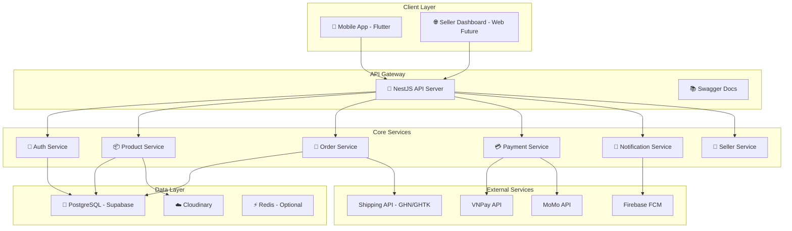
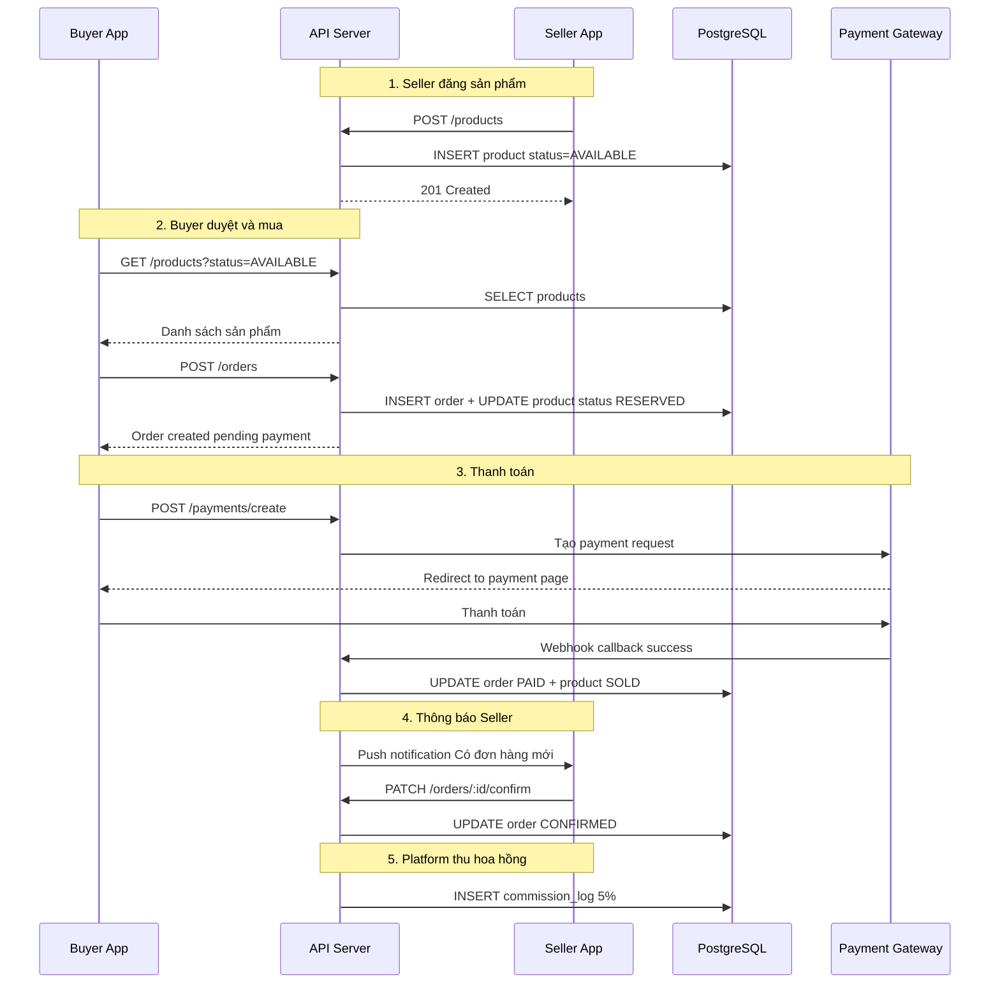
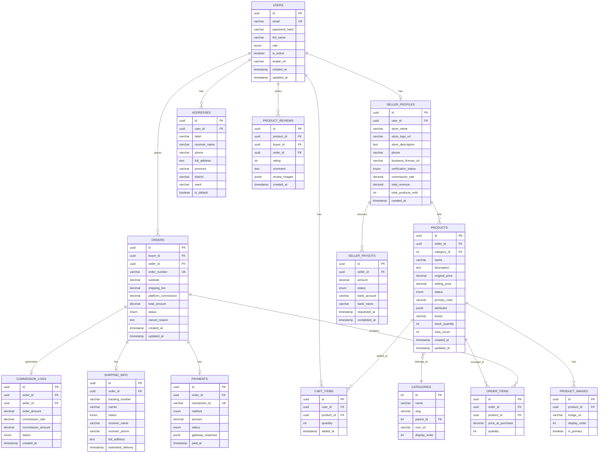
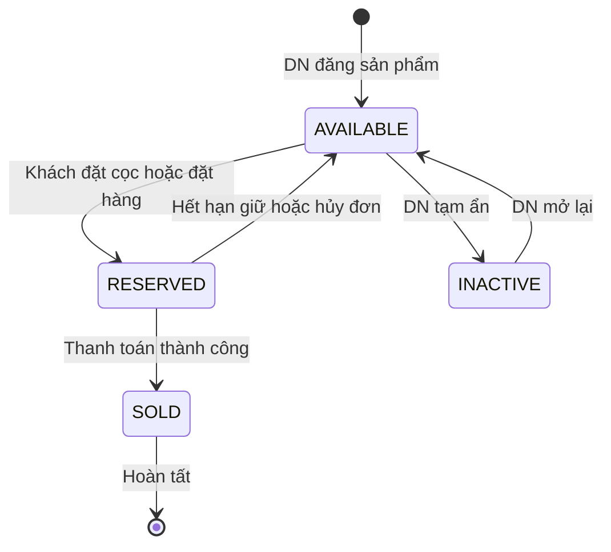
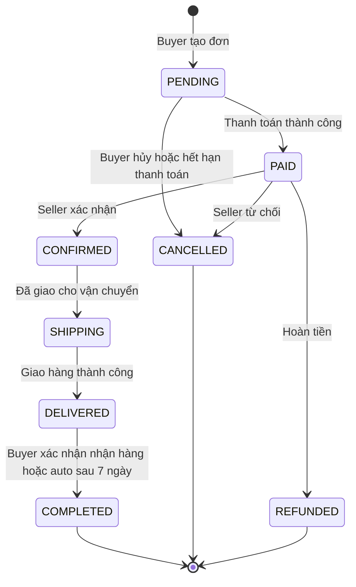

# 📋 Kế Hoạch Xây Dựng Nền Tảng Marketplace Thời Trang B2B2C

> **Dự án**: Fashion Marketplace Platform (tên gọi tạm: **WEARSY Market**)
> **Nền tảng cốt lõi**: Fork từ codebase WEARSY hiện tại
> **Mô hình kinh doanh**: Commission-based (thu % hoa hồng trên mỗi giao dịch)
> **Ngày lập**: 12/10/2026

---

## 1. Tổng Quan Dự Án

### 1.1 Vấn đề cần giải quyết
Các DN bán lẻ thời trang nhỏ/vừa thiếu nền tảng hiệu quả để tiếp cận người tiêu dùng trực tuyến. Họ cần một công cụ đơn giản để quản lý sản phẩm, cập nhật trạng thái (chưa bán / đã đặt cọc / đã bán), và kết nối trực tiếp với khách hàng.

### 1.2 Giải pháp
Xây dựng nền tảng trung gian (Marketplace) kết nối **Doanh nghiệp bán lẻ thời trang** với **Người dùng cuối**, nơi:
- **DN (Seller)**: Đăng sản phẩm, cập nhật trạng thái tự động, quản lý đơn hàng
- **Người dùng (Buyer)**: Duyệt, mua, đặt cọc, thanh toán trực tiếp trên app
- **Platform (WEARSY Market)**: Thu hoa hồng % trên mỗi giao dịch thành công

### 1.3 Tái sử dụng từ WEARSY hiện tại

| Component | Tái sử dụng | Ghi chú |
|---|---|---|
| NestJS Backend Framework | ✅ 100% | app.module, config, middleware, pipes |
| Auth System (JWT + OTP + SSO) | ✅ 95% | Thêm role `SELLER` / `ADMIN` |
| TypeORM + PostgreSQL | ✅ 100% | Thêm entities mới cho Marketplace |
| Cloudinary (ảnh sản phẩm) | ✅ 100% | Dùng lại service upload ảnh |
| Mail Service (Resend/Nodemailer) | ✅ 100% | Gửi notification đơn hàng |
| Flutter Mobile App | ✅ ~60% | Giữ auth, theme, core. Viết lại features |
| Gemini AI | ⚠️ Tùy chọn | Có thể dùng cho gợi ý SP thông minh |
| Swagger Docs | ✅ 100% | Tự động sinh API docs |
| Helmet + CORS + Rate Limiting | ✅ 100% | Security layer giữ nguyên |
| Gamification System | ❌ Loại bỏ | Không phù hợp marketplace |
| Wardrobe/Outfit AI System | ❌ Loại bỏ | Không phù hợp marketplace |

---

## 2. Kiến Trúc Hệ Thống

### 2.1 Sơ đồ tổng thể



### 2.2 Luồng dữ liệu chính



---

## 3. Database Schema (ERD)

### 3.1 Entity Relationship Diagram



### 3.2 Trạng thái Sản phẩm (Product Status Flow)



### 3.3 Trạng thái Đơn hàng (Order Status Flow)



---

## 4. Cấu Trúc Thư Mục Dự Án Mới

```text
/wearsy-market (Fork từ WEARSY)
├── .agents/
├── apps/
│   ├── mobile-client/              # Flutter App (Buyer + Seller views)
│   │   ├── assets/
│   │   ├── lib/
│   │   │   ├── core/               # ✅ GIỮ NGUYÊN từ WEARSY
│   │   │   │   ├── constants/
│   │   │   │   ├── localization/
│   │   │   │   ├── network/
│   │   │   │   ├── storage/
│   │   │   │   ├── theme/
│   │   │   │   └── utils/
│   │   │   ├── features/           # 🔄 VIẾT MỚI
│   │   │   │   ├── auth/           # ✅ Giữ + thêm role selector
│   │   │   │   ├── home/           # 🆕 Feed sản phẩm cho Buyer
│   │   │   │   ├── product/        # 🆕 Chi tiết SP, search, filter
│   │   │   │   ├── cart/           # 🆕 Giỏ hàng
│   │   │   │   ├── checkout/       # 🆕 Thanh toán + địa chỉ
│   │   │   │   ├── orders/         # 🆕 Quản lý đơn hàng (Buyer view)
│   │   │   │   ├── seller/         # 🆕 Dashboard bán hàng
│   │   │   │   │   ├── dashboard/
│   │   │   │   │   ├── products/   # CRUD sản phẩm + cập nhật status
│   │   │   │   │   ├── orders/     # Quản lý đơn hàng (Seller view)
│   │   │   │   │   └── analytics/  # Doanh thu, thống kê
│   │   │   │   ├── profile/        # ✅ Giữ + thêm seller profile
│   │   │   │   └── reviews/        # 🆕 Đánh giá sản phẩm
│   │   │   └── shared/             # ✅ GIỮ NGUYÊN
│   │   └── test/
│   │
│   └── api-server/                 # NestJS Backend
│       ├── src/
│       │   ├── config/             # ✅ GIỮ NGUYÊN
│       │   ├── controllers/        # 🔄 Thay đổi
│       │   │   ├── auth.controller.ts        # ✅ Giữ
│       │   │   ├── health.controller.ts      # ✅ Giữ
│       │   │   ├── products.controller.ts    # 🆕
│       │   │   ├── orders.controller.ts      # 🆕
│       │   │   ├── payments.controller.ts    # 🆕
│       │   │   ├── cart.controller.ts        # 🆕
│       │   │   ├── seller.controller.ts      # 🆕
│       │   │   └── reviews.controller.ts     # 🆕
│       │   ├── models/             # 🔄 Thay đổi
│       │   │   ├── user.entity.ts            # ✅ Giữ + thêm role SELLER
│       │   │   ├── seller-profile.entity.ts  # 🆕
│       │   │   ├── product.entity.ts         # 🆕
│       │   │   ├── product-image.entity.ts   # 🆕
│       │   │   ├── category.entity.ts        # ✅ Giữ + mở rộng
│       │   │   ├── order.entity.ts           # 🆕
│       │   │   ├── order-item.entity.ts      # 🆕
│       │   │   ├── payment.entity.ts         # 🆕
│       │   │   ├── shipping-info.entity.ts   # 🆕
│       │   │   ├── cart-item.entity.ts       # 🆕
│       │   │   ├── address.entity.ts         # 🆕
│       │   │   ├── commission-log.entity.ts  # 🆕
│       │   │   ├── seller-payout.entity.ts   # 🆕
│       │   │   └── product-review.entity.ts  # 🆕
│       │   ├── services/           # 🔄 Thay đổi
│       │   │   ├── auth.service.ts           # ✅ Giữ
│       │   │   ├── mail.service.ts           # ✅ Giữ
│       │   │   ├── cloudinary.service.ts     # ✅ Giữ
│       │   │   ├── products.service.ts       # 🆕
│       │   │   ├── orders.service.ts         # 🆕
│       │   │   ├── payment.service.ts        # 🆕
│       │   │   ├── cart.service.ts           # 🆕
│       │   │   ├── seller.service.ts         # 🆕
│       │   │   ├── shipping.service.ts       # 🆕
│       │   │   ├── commission.service.ts     # 🆕
│       │   │   └── reviews.service.ts        # 🆕
│       │   ├── dto/
│       │   ├── guards/
│       │   │   ├── jwt-auth.guard.ts         # ✅ Giữ
│       │   │   └── roles.guard.ts            # 🆕 RBAC Guard
│       │   ├── routes/
│       │   └── types/
│       └── tests/
│
├── packages/
│   ├── shared-types/               # ✅ Giữ + mở rộng
│   └── custom-lint/                # ✅ Giữ
│
├── infrastructure/
│   ├── docker/
│   └── scripts/
│
├── docs/
│   └── Plan/                       # 📁 Thư mục lưu kế hoạch
└── AGENTS.md
```

---

## 5. Chi Phí Vận Hành (Operating Costs)

> [!IMPORTANT]
> Ước tính cho quy mô nhỏ: **< 100 DN, < 10.000 người dùng, < 50.000 sản phẩm**

### 5.1 Bảng tổng hợp chi phí hàng tháng

| Hạng mục | Dịch vụ | Free Tier | Gói phù hợp | Chi phí/tháng (VNĐ) |
|---|---|---|---|---|
| **🐘 Database** | Supabase PostgreSQL | 500MB, 50K rows | Pro Plan | ~600.000đ ($25) |
| **🖥️ Backend Hosting** | Render.com | Free 750h/mo | Starter $7 | ~170.000đ |
| **☁️ Image CDN** | Cloudinary | 25GB bandwidth | Plus Plan | ~2.200.000đ ($89) |
| **💳 Payment Gateway** | VNPay | — | Theo giao dịch | ~1.1% + 1.500đ/GD |
| **💳 Payment Gateway** | MoMo | — | Theo giao dịch | ~1.5%/GD |
| **📧 Email Service** | Resend | 100 email/ngày free | Pro $20 | ~480.000đ |
| **🚚 Shipping API** | GHN / GHTK | Free API | Theo đơn | 0đ (DN chịu phí ship) |
| **🔔 Push Notification** | Firebase FCM | Free | Free | 0đ |
| **🌐 Domain** | .vn / .com | — | Hàng năm | ~30.000đ/tháng |
| **🔒 SSL** | Let's Encrypt | Free | Free | 0đ |
| **📊 Analytics** | Google Analytics | Free | Free | 0đ |

### 5.2 Tổng chi phí theo giai đoạn

#### 🟢 Giai đoạn MVP (0-3 tháng đầu) — Tối thiểu

| Hạng mục | Chi phí/tháng |
|---|---|
| Supabase Free Tier | **0đ** |
| Render Free Tier | **0đ** |
| Cloudinary Free Tier 25GB | **0đ** |
| Firebase FCM | **0đ** |
| Resend Free Tier 100 emails/ngày | **0đ** |
| Domain .com | ~30.000đ |
| **TỔNG MVP** | **~30.000đ/tháng** |

> [!TIP]
> Với free tier, bạn có thể chạy MVP hoàn toàn **GẦN NHƯ MIỄN PHÍ** (trừ domain) trong 3 tháng đầu để validate ý tưởng.

#### 🟡 Giai đoạn Growth (3-12 tháng) — Scale nhẹ

| Hạng mục | Chi phí/tháng |
|---|---|
| Supabase Pro | ~600.000đ |
| Render Starter | ~170.000đ |
| Cloudinary Plus | ~2.200.000đ |
| Resend Pro | ~480.000đ |
| Payment Gateway fees | ~200.000đ (ước tính) |
| Domain | ~30.000đ |
| **TỔNG GROWTH** | **~3.680.000đ/tháng** |

#### 🔴 Giai đoạn Scale (12+ tháng) — Production

| Hạng mục | Chi phí/tháng |
|---|---|
| Supabase Team / Self-hosted | ~2.400.000đ ($99) |
| AWS / GCP VM 2vCPU 4GB | ~1.200.000đ |
| Cloudinary Advanced | ~5.300.000đ ($219) |
| Redis Cloud | ~720.000đ ($30) |
| Resend Business | ~1.200.000đ |
| Monitoring Sentry | ~600.000đ |
| Payment Gateway fees | ~1.000.000đ |
| **TỔNG SCALE** | **~12.420.000đ/tháng** |

### 5.3 Chi phí Payment Gateway chi tiết

| Gateway | Phí cố định | Phí % | Ví dụ đơn 500.000đ |
|---|---|---|---|
| **VNPay** QR/ATM | 1.500đ/GD | 1.1% | 7.000đ |
| **VNPay** Visa/Master | 1.500đ/GD | 2.2% | 12.500đ |
| **MoMo** | 0đ | 1.5% | 7.500đ |
| **ZaloPay** | 0đ | 1.5% | 7.500đ |

### 5.4 Mô hình doanh thu Commission

> [!NOTE]
> Giả sử commission rate = **5%** trên mỗi đơn hàng thành công.

| Kịch bản | Số đơn/tháng | Giá trị TB/đơn | Doanh thu Platform | Trừ Payment fee ~1.5% | Lợi nhuận gộp |
|---|---|---|---|---|---|
| Khởi đầu | 100 đơn | 300.000đ | 1.500.000đ | -450.000đ | **1.050.000đ** |
| Tăng trưởng | 500 đơn | 400.000đ | 10.000.000đ | -3.000.000đ | **7.000.000đ** |
| Ổn định | 2.000 đơn | 500.000đ | 50.000.000đ | -15.000.000đ | **35.000.000đ** |

**Break-even (Hòa vốn)**: Khoảng **350-500 đơn/tháng** với chi phí Growth ~3.7tr/tháng.

---

## 6. Tech Stack Tổng Hợp

### 6.1 Backend (Giữ nguyên từ WEARSY)

| Layer | Công nghệ | Giữ/Mới |
|---|---|---|
| Framework | NestJS 10 TypeScript | ✅ Giữ |
| ORM | TypeORM 0.3 | ✅ Giữ |
| Database | PostgreSQL 15 Supabase | ✅ Giữ |
| Auth | JWT + bcrypt + OTP | ✅ Giữ |
| File Upload | Cloudinary + Multer | ✅ Giữ |
| Email | Resend + Nodemailer | ✅ Giữ |
| API Docs | Swagger auto-gen | ✅ Giữ |
| Security | Helmet + Throttler + CORS | ✅ Giữ |
| Payment | VNPay / MoMo SDK | 🆕 Mới |
| Shipping | GHN / GHTK API | 🆕 Mới |
| Push Notification | Firebase FCM | 🆕 Mới |

### 6.2 Mobile (Giữ core từ WEARSY)

| Layer | Công nghệ | Giữ/Mới |
|---|---|---|
| Framework | Flutter Dart 3.x | ✅ Giữ |
| State Management | Provider | ✅ Giữ |
| HTTP Client | http package | ✅ Giữ |
| Image Cache | cached_network_image | ✅ Giữ |
| Auth Google/FB | google_sign_in, flutter_facebook_auth | ✅ Giữ |
| Secure Storage | flutter_secure_storage | ✅ Giữ |
| Theme System | AppTheme + AppFonts | ✅ Giữ |
| Localization | intl | ✅ Giữ |
| Camera/Gallery | image_picker | ✅ Giữ |
| Deep Linking | go_router | 🆕 Mới |
| Infinite Scroll | infinite_scroll_pagination | 🆕 Mới |

---

## 7. API Endpoints Chính

### 7.1 Auth (Giữ nguyên + mở rộng)

| Method | Endpoint | Mô tả |
|---|---|---|
| POST | `/v1/auth/register` | Đăng ký (Buyer mặc định) |
| POST | `/v1/auth/login` | Đăng nhập |
| POST | `/v1/auth/sso` | Đăng nhập Google/Facebook |
| POST | `/v1/auth/otp/send` | Gửi OTP |
| POST | `/v1/auth/otp/verify` | Xác thực OTP |

### 7.2 Products (🆕)

| Method | Endpoint | Role | Mô tả |
|---|---|---|---|
| GET | `/v1/products` | Public | Danh sách SP filter search paginate |
| GET | `/v1/products/:id` | Public | Chi tiết SP |
| POST | `/v1/products` | Seller | Tạo SP mới |
| PATCH | `/v1/products/:id` | Seller | Cập nhật SP |
| PATCH | `/v1/products/:id/status` | Seller | Cập nhật trạng thái AVAILABLE/RESERVED/SOLD/INACTIVE |
| DELETE | `/v1/products/:id` | Seller | Xóa SP soft delete |

### 7.3 Cart (🆕)

| Method | Endpoint | Role | Mô tả |
|---|---|---|---|
| GET | `/v1/cart` | Buyer | Xem giỏ hàng |
| POST | `/v1/cart` | Buyer | Thêm SP vào giỏ |
| PATCH | `/v1/cart/:id` | Buyer | Cập nhật số lượng |
| DELETE | `/v1/cart/:id` | Buyer | Xóa khỏi giỏ |

### 7.4 Orders (🆕)

| Method | Endpoint | Role | Mô tả |
|---|---|---|---|
| POST | `/v1/orders` | Buyer | Tạo đơn hàng |
| GET | `/v1/orders` | Buyer/Seller | Danh sách đơn hàng |
| GET | `/v1/orders/:id` | Buyer/Seller | Chi tiết đơn hàng |
| PATCH | `/v1/orders/:id/confirm` | Seller | Xác nhận đơn |
| PATCH | `/v1/orders/:id/cancel` | Buyer/Seller | Hủy đơn |
| PATCH | `/v1/orders/:id/ship` | Seller | Cập nhật giao hàng |

### 7.5 Payments (🆕)

| Method | Endpoint | Role | Mô tả |
|---|---|---|---|
| POST | `/v1/payments/create` | Buyer | Tạo thanh toán VNPay/MoMo |
| POST | `/v1/payments/webhook/vnpay` | System | VNPay callback |
| POST | `/v1/payments/webhook/momo` | System | MoMo callback |
| GET | `/v1/payments/:id/status` | Buyer | Kiểm tra trạng thái |

### 7.6 Seller Dashboard (🆕)

| Method | Endpoint | Role | Mô tả |
|---|---|---|---|
| POST | `/v1/seller/register` | User | Đăng ký trở thành Seller |
| GET | `/v1/seller/profile` | Seller | Thông tin cửa hàng |
| PATCH | `/v1/seller/profile` | Seller | Cập nhật cửa hàng |
| GET | `/v1/seller/analytics` | Seller | Thống kê doanh thu |
| GET | `/v1/seller/payouts` | Seller | Lịch sử rút tiền |
| POST | `/v1/seller/payouts` | Seller | Yêu cầu rút tiền |

### 7.7 Reviews (🆕)

| Method | Endpoint | Role | Mô tả |
|---|---|---|---|
| POST | `/v1/reviews` | Buyer | Đánh giá sản phẩm sau khi nhận hàng |
| GET | `/v1/reviews/product/:id` | Public | Xem đánh giá SP |

---

## 8. Lộ Trình Triển Khai

### Phase 1 — MVP (4-6 tuần)
- [ ] Fork codebase WEARSY
- [ ] Thiết kế database schema mới
- [ ] Mở rộng Auth (thêm role SELLER)
- [ ] CRUD Products + Status management
- [ ] Giao diện Buyer: Feed, chi tiết SP, tìm kiếm
- [ ] Giao diện Seller: Đăng SP, quản lý SP, cập nhật status
- [ ] Giỏ hàng cơ bản
- [ ] Đơn hàng cơ bản (COD — thanh toán khi nhận hàng)

### Phase 2 — Payment and Shipping (3-4 tuần)
- [ ] Tích hợp VNPay
- [ ] Tích hợp MoMo (tùy chọn)
- [ ] Tích hợp GHN API (tra cứu phí ship + tracking)
- [ ] Webhook handler cho payment callback
- [ ] Commission tracking system

### Phase 3 — UX and Engagement (2-3 tuần)
- [ ] Push notification (Firebase FCM)
- [ ] Review and Rating system
- [ ] Seller analytics dashboard
- [ ] Address management
- [ ] Order tracking UI

### Phase 4 — Scale and Optimize (ongoing)
- [ ] Redis caching (product catalog, session)
- [ ] Image optimization pipeline
- [ ] Seller payout automation
- [ ] Admin panel (web)
- [ ] AI product recommendation (tái sử dụng Gemini)

---

## 9. Rủi Ro và Giải Pháp

| Rủi ro | Mức độ | Giải pháp |
|---|---|---|
| Payment gateway integration phức tạp | 🔴 Cao | Bắt đầu với COD rồi thêm VNPay sau |
| Seller upload ảnh chất lượng kém | 🟡 TB | Hướng dẫn + auto-compress via Cloudinary |
| Dispute giữa Buyer-Seller | 🟡 TB | Thêm hệ thống dispute resolution Phase 3 |
| Render Free Tier bị sleep | 🟢 Thấp | Upgrade Starter $7/tháng khi có user |
| Supabase Free Tier hết quota | 🟡 TB | Monitor usage, upgrade Pro khi cần |

---

## 10. So Sánh Với Đối Thủ

| Tiêu chí | WEARSY Market | Shopee | Chợ Tốt |
|---|---|---|---|
| Tập trung ngành | ✅ Chỉ thời trang | ❌ Đa ngành | ❌ Đa ngành |
| Phí cho Seller | 5% commission | 5-10% + phí KM | Gói đăng tin |
| AI Recommend | ✅ Gemini tùy chọn | ✅ Nội bộ | ❌ Không |
| Quy mô mục tiêu | DN nhỏ, shop local | Mọi quy mô | Cá nhân |
| Khác biệt | Chuyên biệt thời trang + trạng thái SP realtime | General marketplace | C2C |

---

## Open Questions

> [!IMPORTANT]
> **Cần xác nhận trước khi bắt đầu code:**

1. **Tên dự án chính thức?** (WEARSY Market / WearsyShop / tên khác?)
2. **Commission rate?** (5% hay tùy chỉnh theo seller?)
3. **Payment gateway ưu tiên?** (VNPay hay MoMo trước?)
4. **Vận chuyển?** (Tích hợp GHN API hay để seller tự xử lý?)
5. **Cần Seller Dashboard web riêng** (React) hay tích hợp luôn trong Flutter app?
6. **Có cần tái sử dụng AI Gemini** cho gợi ý sản phẩm thông minh không?

---

## User Review Required

> [!WARNING]
> **Quyết định kiến trúc quan trọng:**
> - Dự án này nên là **repo RIÊNG** (fork từ WEARSY) vì business domain hoàn toàn khác (Wardrobe Manager vs Marketplace)
> - Nếu đặt chung monorepo sẽ tạo coupling không cần thiết giữa 2 product lines
> - Implementation sẽ là repo riêng, kế hoạch lưu tại đây để reference

> [!CAUTION]
> **Chi phí ẩn cần lưu ý:**
> - VNPay yêu cầu **đăng ký doanh nghiệp** (ĐKKD) để lấy merchant account
> - MoMo Business cũng cần **giấy phép kinh doanh**
> - App Store iOS: **$99/năm** (~2.4tr VNĐ) nếu publish lên App Store
> - Google Play: **$25 một lần** (~600.000đ)

---

*Tài liệu này được tạo dựa trên phân tích codebase WEARSY hiện tại.*
