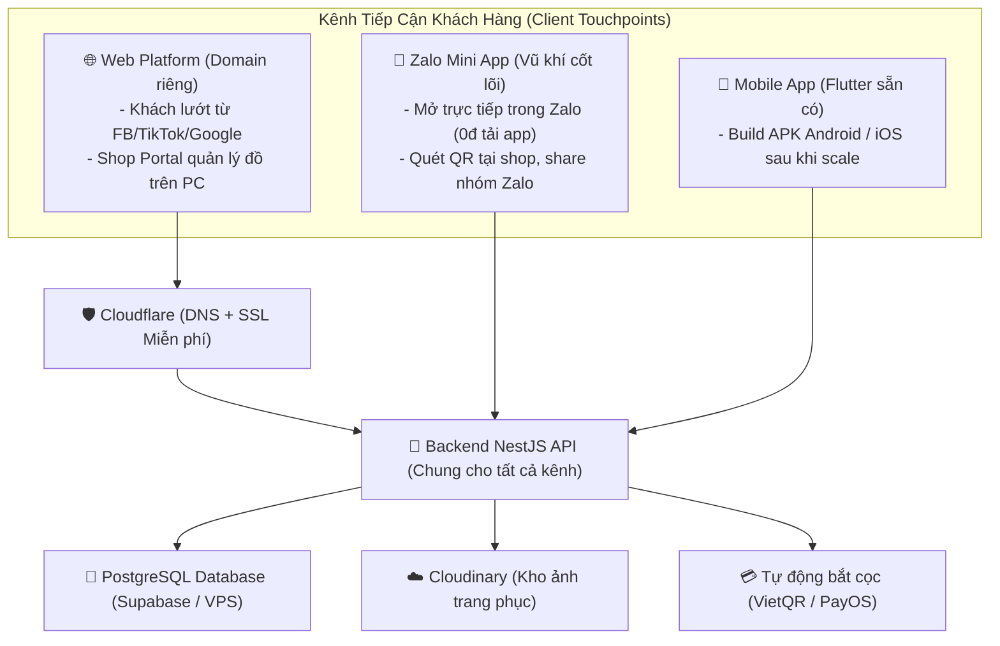

# 🌐📱 BẢN TÓM TẮT TRIỂN KHAI ĐA NỀN TẢNG (WEB + ZALO MINI APP + MOBILE APP) & BẢNG CHI PHÍ VẬN HÀNH
> **Dự án**: Nền tảng kết nối Shop cho thuê trang phục & Khách hàng tại Cần Thơ  
> **Hình thức**: Hệ sinh thái Đa kênh (Web Responsive + Zalo Mini App + Mobile App Flutter)  
> **Hiện trạng**: Đã có sẵn Domain, tận dụng Backend NestJS và Client Flutter từ WEARSY  
> **Ngày cập nhật**: 13/10/2026

---

## 1. Kiến Trúc Đa Nền Tảng: Web + Zalo Mini App + Mobile App

Tất cả các nền tảng phía người dùng đều **sử dụng chung 1 hệ thống Backend NestJS & Database PostgreSQL** duy nhất đã có sẵn từ WEARSY.

### Vai trò từng kênh trong thực tế Cần Thơ:
1. **Zalo Mini App (Khuyên dùng làm kênh khách hàng chính)**:
   - **Không cần tải app**: Khách không phải tốn 50MB-100MB bộ nhớ điện thoại chỉ để thuê 1 bộ đồ.
   - **Mở tức thì**: Quét mã QR đặt tại shop hoặc bấm vào link trong tin nhắn Zalo là vào thẳng app.
   - **Đăng nhập 1-chạm**: Tự động nhận diện số điện thoại Zalo của khách (không cần tạo mật khẩu rườm rà).
   - **Miễn phí phát hành**: Nền tảng Zalo Mini App **hoàn toàn miễn phí**, không mất phí thường niên.
2. **Website (Domain riêng đã có)**:
   - Khách hàng tìm kiếm Google (SEO Cần Thơ: "thuê áo dài Cần Thơ", "thuê đồ kỷ yếu Ninh Kiều...").
   - **Shop Portal**: Giao diện website trên máy tính giúp các chủ shop dễ dàng gõ mô tả, xem bảng lịch và quản lý hàng chục bộ trang phục nhanh chóng.
3. **Mobile App Flutter (Tận dụng codebase WEARSY)**:
   - Có thể xuất file `.apk` cài đặt trực tiếp miễn phí cho Android.
   - Khi có quy mô lớn (Phase 3) mới cần chi tiền đưa lên Google Play & Apple App Store.

---

## 2. Bảng Chi Phí Triển Khai & Vận Hành Toàn Diện

Do **bạn đã có sẵn Domain**, chi phí tên miền là **0đ**.

### BẢNG CHI PHÍ THEO 3 GIAI ĐOẠN PHÁT TRIỂN

| Hạng mục | 🟢 Giai đoạn 1: MVP Tinh Gọn **(Web + Zalo Mini App)** | 🟡 Giai đoạn 2: Chuyên Nghiệp *(Khuyên dùng)* **(Web + Zalo Mini App + APK)** | 🔴 Giai đoạn 3: Toàn Diện (Scale) **(Web + Zalo Mini App + iOS + Android Store)** |
|---|---|---|---|
| **Tên miền (Domain)** | **0đ** *(Đã có)* | **0đ** *(Đã có)* | **0đ** *(Đã có)* |
| **SSL & CDN Tăng tốc** | **0đ** *(Cloudflare Free)* | **0đ** *(Cloudflare Free)* | **0đ** *(Cloudflare Free)* |
| **Hosting Website** | **0đ** *(Cloudflare Pages / Vercel)* | **0đ** *(Cloudflare Pages / Vercel)* | **0đ** *(Vercel)* |
| **Phát hành Zalo Mini App** | **0đ** *(Zalo miễn phí nền tảng)* | **0đ** *(Zalo miễn phí nền tảng)* | **0đ** *(Zalo miễn phí)* |
| **Phát hành Mobile App Store** | **Chưa triển khai (0đ)** | **0đ** *(Xuất file APK Android cài trực tiếp)* | **~630.000đ** *(Google Play 1 lần)* + **~2.500.000đ/năm** *(Apple Store)* |
| **Backend API (NestJS)** | **0đ** *(Render / Koyeb Free)* | **~80.000đ - 120.000đ/tháng** *(VPS Việt Nam Vietnix/CloudFly)* | **~250.000đ - 350.000đ/tháng** *(VPS 4GB RAM)* |
| **Database (PostgreSQL)** | **0đ** *(Supabase Free 500MB)* | **0đ** *(Tích hợp vào VPS hoặc Supabase)* | **~600.000đ/tháng** *(Supabase Pro)* |
| **Kho lưu trữ ảnh đồ** | **0đ** *(Cloudinary Free 25GB)* | **0đ** *(Cloudinary Free ~10.000 ảnh)* | **~150.000đ/tháng** *(Cloudflare R2)* |
| **Check cọc tự động 24/7** | **0đ** *(Quét VietQR, kiểm tra tay)* | **~50.000đ/tháng** *(PayOS / SePay kết nối tài khoản)* | **~150.000đ/tháng** *(PayOS Doanh nghiệp)* |
| **Báo đơn cho Chủ Shop** | **0đ** *(Telegram Bot thông báo tức thì)* | **0đ** *(Telegram Bot thông báo tức thì)* | **~100.000đ/tháng** *(Zalo ZNS / SMS)* |
| **👉 TỔNG CHI PHÍ / THÁNG** | **0 VNĐ / tháng** | **~130.000đ - 170.000đ / tháng** | **~1.150.000đ - 1.650.000đ / tháng** *(+ Phí Apple Store)* |

---

## 3. So Sánh: Zalo Mini App vs Mobile App Tải Về Tại Cần Thơ

| Tiêu chí | 💬 Zalo Mini App *(Chiến lược tối ưu)* | 📱 Mobile App Tải Về (App Store / Google Play) |
|---|---|---|
| **Rào cản người dùng** | **Gần như bằng 0** (Bấm link/quét QR là vào ngay, không cần cài đặt) | **Rất cao** (Phải vào App Store tải 50-100MB, đăng ký tài khoản, dễ bỏ cuộc) |
| **Chi phí xuất bản** | **0 VNĐ** (Nền tảng Zalo mở miễn phí cho lập trình viên) | **$25** Google Play (1 lần) + **$99/năm** Apple Developer (~2.5 triệu/năm) |
| **Đăng nhập & Xác thực** | **1 chạm** bằng số Zalo sẵn có | Phải nhập Email, SĐT, OTP, nhớ mật khẩu |
| **Khả năng viral tại Cần Thơ** | **Cực mạnh** (Dễ dàng gửi qua nhóm Zalo bạn bè rủ nhau thuê đồ kỷ yếu/tiệc) | Thấp (Ít người chịu tải app chỉ để thuê đồ 1-2 lần/năm) |
| **Thời gian phát triển** | Rất nhanh (Code bằng React/Vite hoặc nhúng Webview) | Tốn công kiểm duyệt Apple App Store (3-7 ngày, dễ bị từ chối) |

---

## 4. Bài Toán Doanh Thu & Hòa Vốn (Break-Even)

Giả sử mức hoa hồng nền tảng thu là **10% / đơn thuê**:
- Giá thuê 1 bộ đồ trung bình (áo dài, đầm dạ hội, vest, cosplay...): **150.000đ - 300.000đ / lần thuê**.
- Hoa hồng nhận được: **15.000đ - 30.000đ / đơn**.

| Chỉ số | Giai đoạn 1 (MVP: 0đ/tháng) | Giai đoạn 2 (Chuyên nghiệp: ~150k/tháng) |
|---|---|---|
| **Số đơn thuê để hòa vốn** | **0 đơn** | **Chỉ cần 6 - 8 đơn thuê / tháng** |
| Doanh thu khi có 50 đơn/tháng | ~1.000.000đ *(Lãi trọn vẹn)* | ~1.000.000đ *(Lãi ~850.000đ)* |
| Doanh thu khi có 200 đơn/tháng | ~4.000.000đ *(Lãi trọn vẹn)* | ~4.000.000đ *(Lãi ~3.850.000đ)* |

---

## 5. Lộ Trình Triển Khai Đề Xuất (3 Bước Thông Minh)

1. **Bước 1 (Tuần 1 - 2): Triển khai Website (Domain đã có) + Web Portal cho Shop**
   - Đưa Backend NestJS và Frontend Web lên (Vercel + Supabase).
   - Gặp 3 - 5 shop cho thuê đồ tại Ninh Kiều/Cần Thơ làm mẫu, tạo tài khoản portal và đăng 20-30 mẫu đồ lên thử nghiệm.
2. **Bước 2 (Tuần 3 - 4): Ra mắt Zalo Mini App**
   - Đóng gói giao diện khách hàng thành Zalo Mini App.
   - In mã QR Zalo Mini App dán tại quầy của các shop đối tác: *"Quét mã để xem trước toàn bộ mẫu đồ và đặt cọc online không cần chờ"*.
   - Kích hoạt PayOS tự động bắt cọc ngân hàng (chỉ tốn ~50k/tháng hoặc free).
3. **Bước 3 (Tháng thứ 3 trở đi): Xuất bản App Store / Google Play (Nếu thực sự cần thiết)**
   - Khi lượng người dùng trung thành lớn và các shop muốn nhận push notification chuyên sâu, tiến hành build bản Flutter lên Google Play và Apple App Store.
